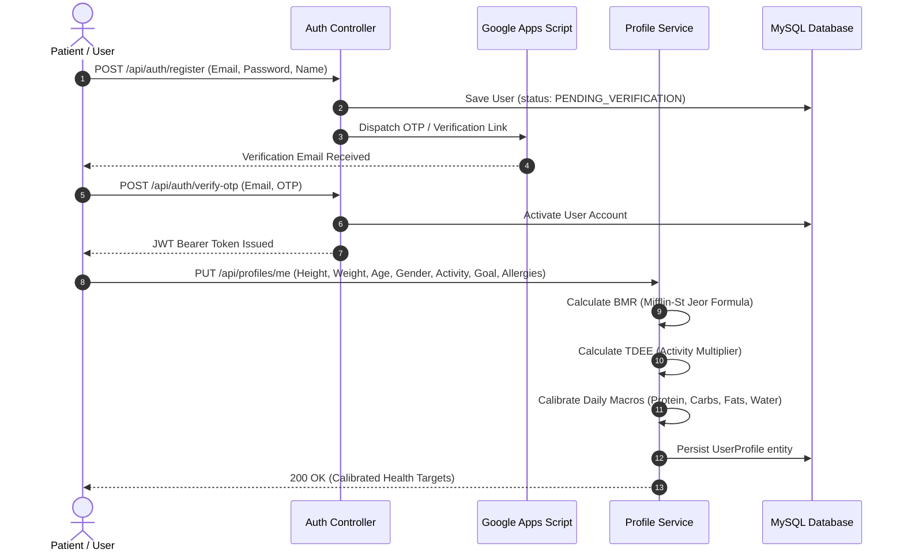
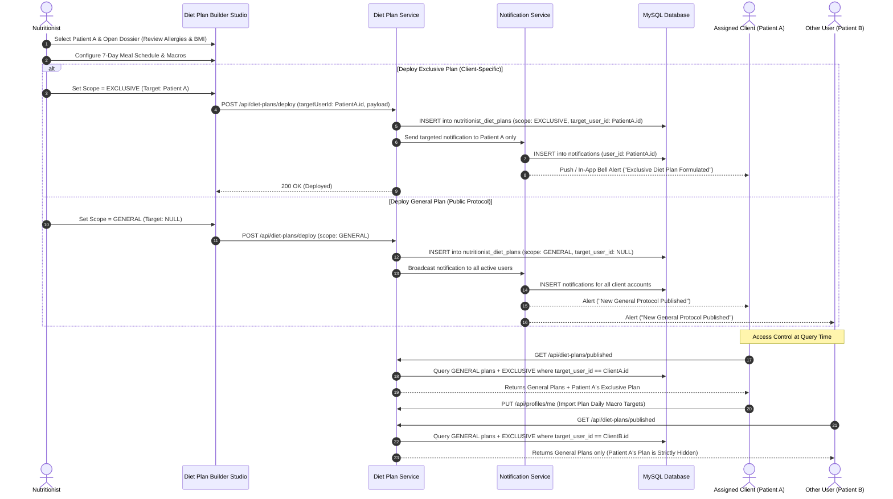
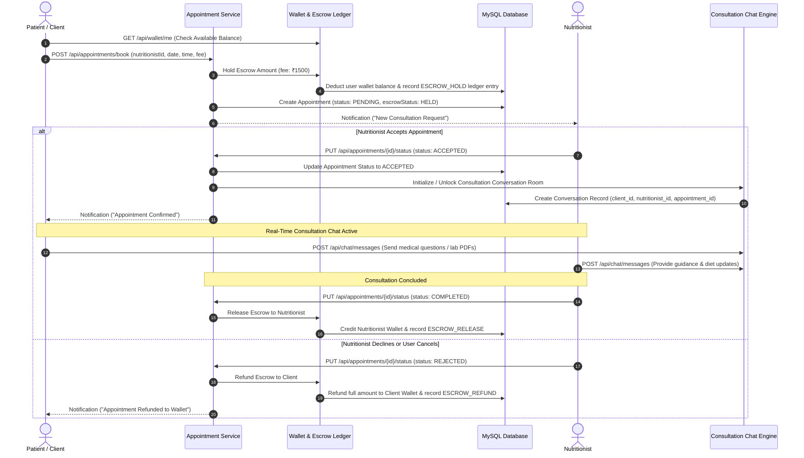
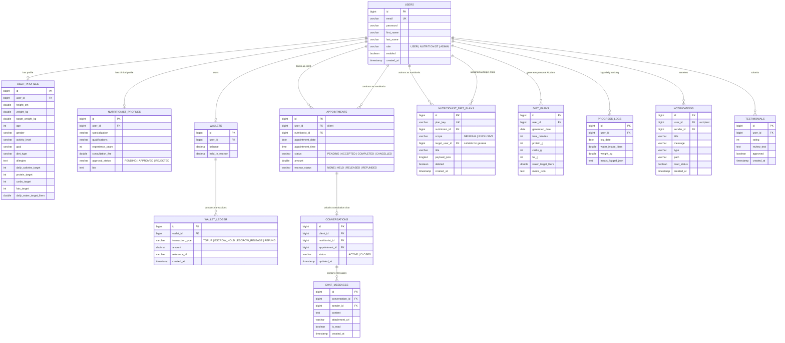

# NutriMunch AI — Clinical Nutrition & Dietary Management Platform

[](https://spring.io/projects/spring-boot)
[](https://react.dev/)
[](https://www.oracle.com/java/)
[](https://vitejs.dev/)
[](https://tailwindcss.com/)
[](https://www.mysql.com/)
[](https://flywaydb.org/)
[](https://deepmind.google/technologies/gemini/)

NutriMunch AI is an enterprise-grade clinical nutrition, dietetics, and patient-telehealth management ecosystem. It seamlessly bridges **Clients (Patients)** seeking calibrated wellness, **Certified Nutritionists (Dietitians)** prescribing bespoke clinical protocols, and **Platform Administrators** auditing telehealth integrity, escrow disbursements, and system telemetry.

---

## Table of Contents

- [1. System Architecture](#1-system-architecture)
- [2. Core Feature Ecosystem](#2-core-feature-ecosystem)
  - [2.1 Client / User Portal](#21-client--user-portal)
  - [2.2 Nutritionist Clinical Suite](#22-nutritionist-clinical-suite)
  - [2.3 Administrator Command Center](#23-administrator-command-center)
- [3. Application Flows & Diagrams](#3-application-flows--diagrams)
  - [3.1 User Onboarding & Metabolic Profile Calibration](#31-user-onboarding--metabolic-profile-calibration)
  - [3.2 Clinical Diet Plan Lifecycle & Access Control](#32-clinical-diet-plan-lifecycle--access-control)
  - [3.3 Consultation Booking, Escrow Payment & Chat Lifecycle](#33-consultation-booking-escrow-payment--chat-lifecycle)
- [4. Database Architecture & ERD](#4-database-architecture--erd)
- [5. Role-Based Access Control (RBAC) Matrix](#5-role-based-access-control-rbac-matrix)
- [6. Technology Stack](#6-technology-stack)
- [7. Setup & Installation Guide](#7-setup--installation-guide)
  - [7.1 Prerequisites](#71-prerequisites)
  - [7.2 Environment Configuration](#72-environment-configuration)
  - [7.3 Backend Setup (Spring Boot)](#73-backend-setup-spring-boot)
  - [7.4 Frontend Setup (React + Vite)](#74-frontend-setup-react--vite)
  - [7.5 Running via Docker / Dev Container](#75-running-via-docker--dev-container)
  - [7.6 Seed Data & Initial Credentials](#76-seed-data--initial-credentials)
- [8. REST API Reference](#8-rest-api-reference)
- [9. Project Directory Structure](#9-project-directory-structure)

---

## 1. System Architecture

The following diagram illustrates the high-level multi-tier architecture, showing how client requests interact with Spring Security, business services, the persistence layer, and external AI / payment integrations:

```mermaid
graph TD
    subgraph Client_Layer["Client Presentation Layer (React 19 + Vite)"]
        UI_User["Patient / User Dashboard"]
        UI_Nutri["Nutritionist Clinical Suite"]
        UI_Admin["Admin Telemetry Console"]
        UI_Shared["Shared Layouts & Navigation"]
    end

    subgraph Gateway_Security["Security & Ingress Gateway"]
        CORS["CORS & Request Body Limiter (16MB)"]
        JWT_Filter["JWT Authentication Filter"]
        RBAC["Role-Based Access Control (USER / NUTRITIONIST / ADMIN)"]
    end

    subgraph Service_Layer["Spring Boot 4 Application Core"]
        AuthService["Auth & OTP Service"]
        ProfileService["User & Clinical Profile Service"]
        DietService["Diet Plan & Nutritionist Prescriptions"]
        ApptService["Consultation & Escrow Scheduler"]
        ChatService["Consultation Chat Engine"]
        WalletService["Wallet Ledger & Transaction Engine"]
        NotifService["Notification & Event Dispatcher"]
        AiService["Gemini AI Vision & Diet Engine"]
    end

    subgraph External_Integrations["Third-Party APIs & Services"]
        GeminiAPI["Google Gemini AI API (Vision / 2.5 Flash)"]
        GoogleAuth["Google OAuth2 Identity Provider"]
        GoogleScript["Google Apps Script (Mail & OTP Webhook)"]
        Razorpay["Razorpay Payment Gateway"]
        OpenFoodFacts["OpenFoodFacts Barcode Database"]
    end

    subgraph Data_Storage["Persistence Layer (MySQL 8.0)"]
        DB_Users[("Users & Credentials")]
        DB_Profiles[("Biometrics & Allergies")]
        DB_DietPlans[("Diet Plans & Prescriptions")]
        DB_Consult[("Appointments & Escrow")]
        DB_Chat[("Conversations & Messages")]
        DB_Wallet[("Wallets & Audit Ledgers")]
        DB_Notifs[("In-App Notifications")]
        Flyway["Flyway Versioned Migrations (V1-V26)"]
    end

    UI_User --> CORS
    UI_Nutri --> CORS
    UI_Admin --> CORS
    UI_Shared --> CORS

    CORS --> JWT_Filter --> RBAC

    RBAC --> AuthService
    RBAC --> ProfileService
    RBAC --> DietService
    RBAC --> ApptService
    RBAC --> ChatService
    RBAC --> WalletService
    RBAC --> NotifService
    RBAC --> AiService

    AuthService --> GoogleAuth
    AuthService --> GoogleScript
    AiService --> GeminiAPI
    AiService --> OpenFoodFacts
    WalletService --> Razorpay

    AuthService --> DB_Users
    ProfileService --> DB_Profiles
    DietService --> DB_DietPlans
    ApptService --> DB_Consult
    ChatService --> DB_Chat
    WalletService --> DB_Wallet
    NotifService --> DB_Notifs
    Flyway -.-> Data_Storage
```




---

## 2. Core Feature Ecosystem

### 2.1 Client / User Portal
* **Biometric Profile & Targets Engine:** Calculates Basal Metabolic Rate (BMR) and Total Daily Energy Expenditure (TDEE) based on age, height, weight, gender, activity multiplier, and fitness goals. Supports custom overrides for target macros and hydration.
* **Progress & Hydration Suite:** Interactive fluid tracking with animated circular SVG gauges, milestone weight logs, and daily manual meal nutrition journals.
* **AI Diet Generator:** Uses Google Gemini to generate custom 7-day meal plans matching specific calorie constraints, cuisine preferences, and medical exclusions.
* **AI Food Vision & Barcode Scanner:** Real-time camera or image upload analyzed by Gemini Vision to extract calorie counts and macronutrient distributions; barcode lookup backed by OpenFoodFacts.
* **Diet Plans Library:** Browse both general wellness protocols and **exclusive clinical diet plans** formulated specifically for the user by their assigned nutritionist. Includes a 1-click requirement import to automatically re-calibrate daily tracking targets.
* **Consultation Booking & Escrow Protection:** Schedule 1-on-1 consultations with verified dietitians. Consultation fees are placed in secure escrow from the in-app wallet until the session is completed.
* **Real-Time Telehealth Chat:** Rich text messaging with file/report attachments, auto-updating unread indicators, and lifecycle status management.
* **In-App Wallet:** Instant balance top-ups via Razorpay, transaction history auditing, and automated escrow hold/release/refund capabilities.

### 2.2 Nutritionist Clinical Suite
* **Clinical Command Dashboard:** High-level practice metrics including pending appointments, completed consultations, total earnings, and assigned patient roster.
* **Patient Profile & Synced Dossier Modal:** Comprehensive clinical view of patient anthropometrics (height, weight, BMI), health goals, food allergies, dietary restrictions, and caloric baseline.
* **Diet Plan Builder Studio:** Professional 7-day macro and micronutrient authoring suite. Nutritionists can adjust target calories, protein, carbs, fats, water, fiber, iron, calcium, vitamin D, and configure specific meal slots across breakfast, lunch, snacks, and dinner.
* **Access-Controlled Plan Publishing:**
  * **General Protocols:** Published globally for all platform users to inspect and adopt.
  * **Client-Specific (Exclusive) Prescriptions:** Assigned strictly to an individual patient with whom the nutritionist has an accepted consultation. Encrypted and restricted on the server to prevent exposure to other users.
* **Consultation & Schedule Management:** Set custom time slot availability, approve or decline patient consultation requests, and launch secure direct consultation chats.

### 2.3 Administrator Command Center
* **Platform Telemetry:** Active users, nutritionist verifications, total revenue volume, escrow balances, and transaction volume.
* **User & Role Administration:** View all platform accounts, toggle account activation, elevate roles (`USER`, `NUTRITIONIST`, `ADMIN`), and trigger administrative password resets.
* **Nutritionist Credential Verification:** Audit submitted clinical certifications, professional registrations, and degrees; approve or revoke practicing status.
* **Escrow & Refund Auditing:** Direct oversight of held appointment fees; execute administrative refunds back to patient wallets in dispute scenarios.
* **Diet Plan Master Registry:** Audit and permanently purge outdated, duplicated, or non-compliant diet plans across database tables and runtime stores.
* **Live SQL Diagnostic Console:** Read-only and audited diagnostic SQL query execution interface for platform maintenance.


---

## 3. Application Flows & Diagrams

### 3.1 User Onboarding & Metabolic Profile Calibration



### 3.2 Clinical Diet Plan Lifecycle & Access Control



### 3.3 Consultation Booking, Escrow Payment & Chat Lifecycle




---

## 4. Database Architecture & ERD

The backend utilizes Flyway migrations (from baseline `V1` to `V26`) to manage schema evolution. Below is the Entity-Relationship Diagram representing core tables, primary/foreign keys, and relational cardinality:



---

## 5. Role-Based Access Control (RBAC) Matrix

| Resource / Action | Endpoint | USER (Client) | NUTRITIONIST | ADMIN |
| :--- | :--- | :---: | :---: | :---: |
| **Authenticate / Register / OAuth** | `/api/auth/**` | :white_check_mark: | :white_check_mark: | :white_check_mark: |
| **View & Update Own Profile** | `/api/profiles/me` | :white_check_mark: | :white_check_mark: | :white_check_mark: |
| **Inspect All Client Profiles / Dossiers** | `/api/client-profiles` | :x: | :white_check_mark: | :white_check_mark: |
| **Generate Personal AI Diet Plan** | `/api/ai/generate-diet` | :white_check_mark: | :x: | :white_check_mark: |
| **AI Food Image & Barcode Scanner** | `/api/ai/analyze-image`, `/lookup-barcode` | :white_check_mark: | :white_check_mark: | :white_check_mark: |
| **Browse General Diet Plans** | `/api/diet-plans/published`, `/general` | :white_check_mark: | :white_check_mark: | :white_check_mark: |
| **Access Client-Specific (Exclusive) Plan** | `/api/diet-plans/published` | :lock: **Own Only** | :lock: **Authored Only** | :white_check_mark: **All (Audit)** |
| **Deploy & Publish Diet Plans** | `/api/diet-plans/deploy` | :x: | :white_check_mark: | :white_check_mark: |
| **Delete / Purge Published Diet Plans** | `/api/diet-plans/{id}` | :x: | :lock: **Authored Only** | :white_check_mark: **Any** |
| **Book Consultation Appointment** | `/api/appointments/book` | :white_check_mark: | :x: | :white_check_mark: |
| **Manage Slots & Approve/Decline Consults** | `/api/appointments/{id}/status` | :x: | :white_check_mark: | :white_check_mark: |
| **Participate in Consultation Chat** | `/api/chat/**` | :lock: **Assigned Only** | :lock: **Assigned Only** | :white_check_mark: **Audit** |
| **In-App Wallet Topup & Balance** | `/api/wallet/me`, `/topup` | :white_check_mark: | :white_check_mark: | :white_check_mark: |
| **Escrow Management & Manual Refunds** | `/api/admin/refunds/**` | :x: | :x: | :white_check_mark: |
| **Verify Nutritionist Application** | `/api/admin/nutritionists/{id}/approve` | :x: | :x: | :white_check_mark: |
| **System SQL Console & User Admin** | `/api/admin/**` | :x: | :x: | :white_check_mark: |


---

## 6. Technology Stack

### Backend Core
* **Language & Runtime:** Java 17 (OpenJDK / Eclipse Temurin)
* **Framework:** Spring Boot 4.1.0 (Spring MVC, Spring Data JPA, Spring Security, Spring Validation)
* **Database & ORM:** MySQL 8.0, Hibernate 6.x, HikariCP Connection Pooling
* **Database Migrations:** Flyway Database Migrations (MySQL dialect)
* **Security & Token Management:** JJWT (JSON Web Token 0.11.5), BCrypt Password Encoder
* **Documentation:** SpringDoc OpenAPI 2.8.4 (Swagger UI)

### Frontend Core
* **Library & Compiler:** React 19.2 (JavaScript ES Modules, React Router v7)
* **Build Tooling:** Vite 8.2 (HMR, Rollup bundling)
* **Styling & Icons:** Tailwind CSS 3.4, Lucide React Icons, Google Material Symbols
* **State & Data Fetching:** TanStack React Query v5, Axios HTTP Client (Interceptors for Bearer JWT)
* **Charts & Visuals:** Chart.js 4.5, React-ChartJS-2, Framer Motion
* **Utilities:** HTML5-QRCode Scanner, React Helmet Async

### External APIs & Infrastructure
* **AI Engine:** Google Gemini AI API (`gemini-2.5-flash` / `gemini-3.6-flash`)
* **OAuth:** Google Identity Services (`@react-oauth/google`)
* **Email & OTP Delivery:** Google Apps Script Webhook Integration
* **Payments & Escrow:** Razorpay API (Test / Live Gateway integration)
* **Nutritional Data:** OpenFoodFacts REST API

---

## 7. Setup & Installation Guide

### 7.1 Prerequisites
Ensure the following developer tooling is installed locally:
* **Java Development Kit (JDK):** Version 17 or higher (`java -version`)
* **Apache Maven:** Version 3.8+ or use the bundled `./mvnw` wrapper
* **Node.js:** Version 18.x or 20.x LTS (`node -v`)
* **npm:** Version 9.x or higher (`npm -v`)
* **MySQL Server:** Version 8.0+ running on port 3306

---

### 7.2 Environment Configuration

#### Backend Environment (`backend/.env`)
Create or edit `backend/.env` with the following variables:

```properties
# Server Ingress & Client Portals
SERVER_PORT=8080
FRONTEND_LOGIN_URL=http://localhost:5173/login
FRONTEND_ORIGIN=http://localhost:5173,http://localhost:5174

# Database Connection (MySQL)
DB_URL=jdbc:mysql://localhost:3306/nutrition_db?createDatabaseIfNotExist=true&autoReconnect=true&useSSL=false&allowPublicKeyRetrieval=true
DB_USERNAME=root
DB_PASSWORD=password

# Security & Admin Seed
ADMIN_EMAIL=admin@gmail.com
ADMIN_PASSWORD=admin123

# External AI & Google Integrations
GOOGLE_CLIENT_ID=your-google-oauth-client-id.apps.googleusercontent.com
GOOGLE_SCRIPT_URL=https://script.google.com/macros/s/your-apps-script-id/exec
GOOGLE_SCRIPT_API_KEY=your-optional-script-key

GEMMA_API_KEY=your-gemini-api-key
GEMMA_MODEL=gemini-2.5-flash

# Payment Gateway (Razorpay)
RAZORPAY_KEY_ID=rzp_test_yourKeyId
RAZORPAY_KEY_SECRET=yourKeySecret
```

#### Frontend Environment (`frontend/.env`)
Create or edit `frontend/.env`:

```properties
VITE_API_BASE_URL=http://localhost:8080/api
VITE_GOOGLE_CLIENT_ID=your-google-oauth-client-id.apps.googleusercontent.com

# Local Admin Quick-Fill Credentials
VITE_ADMIN_EMAIL=admin@gmail.com
VITE_ADMIN_PASSWORD=admin123
```

---

### 7.3 Backend Setup (Spring Boot)

1. Open a terminal and navigate to the `backend` directory:
   ```bash
   cd backend
   ```
2. Build and verify dependencies using Maven:
   ```bash
   ./mvnw clean install -DskipTests
   ```
   *(On Windows Command Prompt / PowerShell, use `.\mvnw.cmd clean install -DskipTests`)*
3. Run the Spring Boot application:
   ```bash
   ./mvnw spring-boot:run
   ```
4. The backend service will start on `http://localhost:8080`.
   * **Swagger API Documentation:** [http://localhost:8080/swagger-ui.html](http://localhost:8080/swagger-ui.html)
   * **OpenAPI Specification:** [http://localhost:8080/v3/api-docs](http://localhost:8080/v3/api-docs)

---

### 7.4 Frontend Setup (React + Vite)

1. Open a separate terminal and navigate to the `frontend` directory:
   ```bash
   cd frontend
   ```
2. Install dependencies:
   ```bash
   npm install
   ```
3. Start the Vite local development server:
   ```bash
   npm run dev
   ```
4. Access the web application at [http://localhost:5173](http://localhost:5173).

---

### 7.5 Running via Docker / Dev Container

A ready-to-run development container setup is included under `.devcontainer/docker-compose.yml`.

To spin up the containerized MySQL 8.0 instance and development environment:
```bash
docker compose -f .devcontainer/docker-compose.yml up -d
```
This boots MySQL on port `3306` with user `root`, password `password`, and pre-configures the `nutrition_db` database with a persistent Docker volume (`mysql-data`).

---

### 7.6 Seed Data & Initial Credentials

Upon the first backend startup, the system seeds the master administrator account:
* **Admin Email:** `admin@gmail.com`
* **Admin Password:** `admin123`
* **Role:** `ADMIN`

To test nutritionist workflows, register an account via `/register`, choose the **Nutritionist** role, and approve the profile via the Admin Portal at `/dashboard/admin/nutritionists`.

---

## 8. REST API Reference

### Authentication (`/api/auth`)
* `POST /api/auth/register` — Register a new account (`USER` or `NUTRITIONIST`).
* `POST /api/auth/login` — Authenticate with email/password; returns JWT token.
* `POST /api/auth/google` — Sign in or register via Google OAuth2 ID token.
* `POST /api/auth/verify-otp` — Verify email via 6-digit one-time code.
* `POST /api/auth/forgot-password` — Request a password reset link.
* `POST /api/auth/reset-password` — Set a new password using a verified reset token.

### Profiles & Clinical Dossiers (`/api/profiles`, `/api/client-profiles`)
* `GET /api/profiles/me` — Retrieve authenticated user profile and health targets.
* `PUT /api/profiles/me` — Update biometrics, allergies, target goals, and custom macros.
* `GET /api/client-profiles` — Retrieve all assigned patient biometric dossiers *(Nutritionist & Admin only)*.

### Diet Plans & Prescriptions (`/api/diet-plans`)
* `GET /api/diet-plans/published` — Access visible diet plans (General + user-specific exclusive plans).
* `GET /api/diet-plans/general` — Retrieve the latest active general protocol.
* `POST /api/diet-plans/deploy` — Author and publish a general or client-specific diet plan *(Nutritionist only)*.
* `DELETE /api/diet-plans/{id}` — Soft-delete a published diet plan *(Author or Admin only)*.
* `GET /api/diet-plans/me` — Retrieve personal AI-generated diet plan history.
* `GET /api/diet-plans/all` — Master audit list of all plans *(Admin only)*.

### AI Engine (`/api/ai`)
* `POST /api/ai/generate-diet` — Generate a 7-day meal plan based on profile constraints.
* `POST /api/ai/analyze-image` — Analyze food photography for calories and macros via Gemini Vision.
* `GET /api/ai/lookup-barcode` — Retrieve nutritional breakdown from an OpenFoodFacts barcode.

### Appointments & Telehealth (`/api/appointments`)
* `GET /api/appointments/me` — Retrieve consultations for the current user or nutritionist.
* `POST /api/appointments/book` — Book a consultation slot and hold fee in escrow.
* `PUT /api/appointments/{id}/status` — Accept, decline, or complete a consultation session.

### Real-Time Consultation Chat (`/api/chat`)
* `GET /api/chat/conversations` — Retrieve active consultation threads for the caller.
* `GET /api/chat/messages` — Fetch message history with pagination.
* `POST /api/chat/messages` — Send a message or medical file attachment.
* `PUT /api/chat/read` — Mark unread messages in a thread as read.

### Wallet & Escrow Ledger (`/api/wallet`, `/api/transactions`)
* `GET /api/wallet/me` — Retrieve available balance and funds held in escrow.
* `POST /api/wallet/topup` — Credit wallet balance via payment gateway order verification.
* `GET /api/transactions/me` — View complete transaction and escrow audit history.

### In-App Notifications (`/api/notifications`)
* `GET /api/notifications/me` — List notifications for the authenticated user.
* `GET /api/notifications/unread-count` — Count of unread alerts for badge display.
* `PUT /api/notifications/{id}/read` — Mark an alert as read.
* `PUT /api/notifications/read-all` — Mark all alerts as read.

---

## 9. Project Directory Structure

```text
NutriMunch-AI/
├── .devcontainer/
│   └── docker-compose.yml              # Local containerized MySQL 8.0 & Dev environment
├── backend/
│   ├── .env                            # Backend environment configuration
│   ├── Dockerfile                      # Multi-stage Maven build & JRE 17 runtime
│   ├── pom.xml                         # Spring Boot 4.1 Maven project descriptor
│   └── src/
│       ├── main/
│       │   ├── java/com/nutrition/
│       │   │   ├── config/             # CORS, Async, Time, & Request Body filters
│       │   │   ├── controller/         # REST Controllers (Auth, Diet, AI, Chat, Admin...)
│       │   │   ├── dto/                # Data Transfer Objects & API Payloads
│       │   │   ├── entity/             # JPA Entities (User, Appointment, DietPlan, Wallet...)
│       │   │   ├── repository/         # Spring Data JPA Repositories
│       │   │   ├── security/           # JWT Provider, CustomUserDetails, & SecurityConfig
│       │   │   └── service/            # Core Business Logic & Domain Services
│       │   └── resources/
│       │       ├── application.yml     # Application configuration & connection pools
│       │       └── db/migration/       # Versioned Flyway SQL migrations (V1 to V26)
│       └── test/                       # Unit & Integration test suites
├── frontend/
│   ├── .env                            # Frontend environment configuration
│   ├── package.json                    # React 19 & Vite dependencies
│   ├── vite.config.js                  # Vite bundler & proxy configuration
│   ├── tailwind.config.js              # Tailwind styling & theme extensions
│   └── src/
│       ├── api/                        # Axios instance with JWT interceptors
│       ├── common/                     # Reusable Navbar, Footer, & Notifications Bell
│       ├── components/                 # Modals, Feature Gates, QR Scanners, Calendar Pickers
│       ├── context/                    # AuthContext & Session management
│       ├── layouts/                    # Global & Role-based dashboard layouts
│       ├── pages/
│       │   ├── Authentication/         # Login, Register, OTP, & Password Reset
│       │   ├── Dashboard/
│       │   │   ├── Admin/              # Users, Refunds, SQL Console, Telemetry
│       │   │   ├── Nutritionist/       # Diet Plan Builder Studio, Appointments Roster
│       │   │   ├── Shared/             # Transaction History & Wallet Ledgers
│       │   │   └── User/               # Diet Plans Library, Progress, AI Tools
│       │   └── HomeSections/           # Public Landing Pages & Testimonials
│       └── utils/                      # Diet plan synchronization & Allergen filters
└── README.md                           # Master project documentation
```

---

## 10. License

This project is licensed under the proprietary development terms of the NutriMunch AI Project. All rights reserved.
